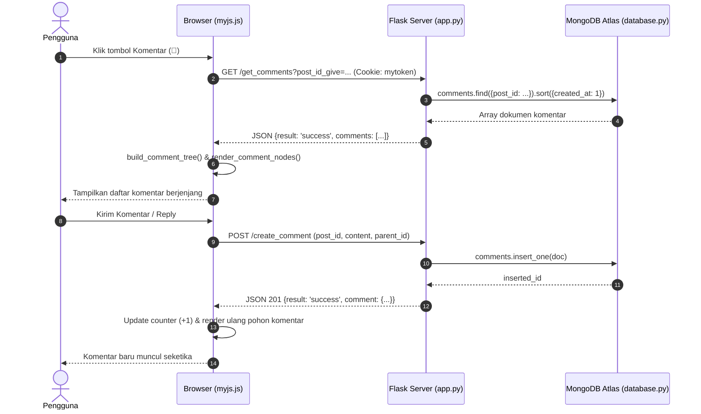

# Sweeter — Comment & Reply System Documentation

Dokumen ini menjelaskan arsitektur, skema database, spesifikasi API, dan implementasi frontend untuk fitur **Comment & Reply System** pada aplikasi Sweeter.

---

## 1. Architecture

### 1.1 Alur Frontend ke Backend
1. Pengguna berinteraksi dengan antarmuka web (menekan tombol komentar, mengetik komentar, atau menekan tombol balas/hapus).
2. JavaScript (`static/myjs.js`) menangkap event, melakukan validasi awal di sisi klien (konten kosong, panjang teks, sanitasi URL).
3. Request dikirim secara asinkron menggunakan jQuery AJAX ke endpoint backend Flask (`app.py`).
4. Kredensial pengguna dikirimkan otomatis melalui HTTP Cookie `mytoken` (JWT simetris HS256).
5. Backend memvalidasi token, mengekstrak identitas pengguna dari payload token, dan menjalankan operasi bisnis.
6. Respons JSON dikembalikan ke frontend.
7. Frontend memperbarui DOM secara selektif tanpa reload seluruh halaman (*zero-refresh*).



### 1.2 Alur Backend ke MongoDB
- Modul `database.py` menginisialisasi client `MongoClient` dari environment variable `MONGODB_CONNECTION_STRING` dengan timeout 5.000 ms.
- Koleksi yang berinteraksi dengan fitur komentar adalah `db.comments`, `db.posts`, dan `db.users`.
- Pada endpoint feed `/get_posts`, query agregasi batch (`$match` dan `$group`) digunakan untuk menghitung jumlah komentar setiap post dalam satu kali pemanggilan database, menghindari masalah *N+1 query*.

### 1.3 Struktur Hubungan Post, Comment, dan Reply
Menggunakan pola **Adjacency List Pattern**:
- **Post:** Dokumen utama di `db.posts` memiliki `_id` bertipe ObjectId.
- **Komentar Utama (Root Comment):** Dokumen di `db.comments` dengan `post_id = str(post._id)` dan `parent_comment_id = null`.
- **Balasan (Reply):** Dokumen di `db.comments` dengan `post_id = str(post._id)` dan `parent_comment_id = str(parent_comment._id)`.
- **Nested Reply (Balasan bertingkat):** Dokumen dengan `parent_comment_id` yang merujuk ke ID dokumen balasan sebelumnya. Kedalaman relasi data di MongoDB tidak dibatasi.

---

## 2. Database

### 2.1 Struktur Collection `comments`
Dokumen disimpan pada collection mandiri bernama `comments`.

| Field | Tipe Data | Keterangan |
|---|---|---|
| `_id` | `ObjectId` | Primary key unik dokumen MongoDB. |
| `post_id` | `String` | ID postingan induk (representasi string dari ObjectId post). |
| `parent_comment_id` | `String` / `null` | `null` untuk komentar utama; ID komentar induk untuk balasan (*reply*). |
| `username` | `String` | ID unik akun pembuat komentar (diambil dari klaim JWT). |
| `profile_name` | `String` | Nama tampilan pengguna saat komentar dibuat. |
| `profile_pic_real` | `String` | Path file foto profil pengguna (misal: `profile_pics/...`). |
| `content` | `String` | Isi teks komentar (maksimal 2.000 karakter). |
| `created_at` | `String` | Timestamp pembuatan format ISO 8601 UTC. |
| `updated_at` | `String` / `null` | Timestamp pembaruan (misal saat soft delete) format ISO 8601 UTC. |
| `is_deleted` | `Boolean` | Status soft delete (`false` aktif, `true` telah dihapus). |

### 2.2 Index yang Digunakan
Diinisialisasi secara otomatis dan *idempotent* melalui fungsi `init_indexes()` di `database.py`:
1. `[("post_id", 1), ("created_at", 1)]` (Compound): Mengoptimalkan kueri pencarian komentar per post terurut waktu secara langsung tanpa operasi in-memory sort.
2. `[("post_id", 1)]`: Mempercepat filter post dan batch aggregation `$match`.
3. `[("parent_comment_id", 1)]`: Mempercepat pelacakan child replies pada relasi hierarkis.
4. `[("username", 1)]`: Mempercepat pencarian atau verifikasi komentar berdasarkan author.
5. `[("created_at", 1)]`: Mempercepat rentang pengurutan waktu.

### 2.3 Mekanisme Soft Delete
- Ketika pengguna menghapus komentar miliknya, dokumen tidak dihapus fisik dari MongoDB (`delete_one` tidak digunakan).
- Dokumen diperbarui dengan `update_one`:
  - `is_deleted: true`
  - `content: "[Komentar ini telah dihapus oleh pengguna]"`
  - `updated_at: <ISO 8601 UTC timestamp>`
- **Tujuan:** Mempertahankan keutuhan pohon percakapan (*conversation tree*). Jika komentar root atau parent dihapus, seluruh balasan (*child replies*) di bawahnya tetap memiliki pointer induk yang sah dan tidak menjadi *orphan*.
- Komentar yang berstatus *soft-deleted* tetap dihitung dalam `count_comments` agar total riwayat percakapan tidak berubah secara tiba-tiba.

---

## 3. API Specification

### 3.1 `POST /create_comment`
Membuat komentar utama baru pada postingan atau membalas komentar yang sudah ada.

- **URL:** `/create_comment`
- **Method:** `POST`
- **Authentication:** Wajib (Cookie `mytoken` berisi JWT yang valid).
- **Content-Type:** `application/x-www-form-urlencoded`
- **Parameters:**
  - `post_id_give` (String, Required): ID postingan target (24-hex ObjectId).
  - `content_give` (String, Required): Teks komentar (1–2.000 karakter, non-whitespace).
  - `parent_comment_id_give` (String, Optional): ID komentar induk jika merupakan reply. Kosongkan jika komentar utama.
- **Success Response (HTTP 201 Created):**
  ```json
  {
    "result": "success",
    "msg": "Comment created successfully",
    "comment": {
      "_id": "6726618a9e1b2c3d4e5f6789",
      "post_id": "67265f018a9e1b2c3d4e1111",
      "parent_comment_id": null,
      "username": "azzam",
      "profile_name": "Azzam",
      "profile_pic_real": "profile_pics/azzam.jpg",
      "content": "Keren sekali!",
      "created_at": "2026-11-02T15:00:00.000Z",
      "updated_at": null,
      "is_deleted": false,
      "is_mine": true
    }
  }
  ```
- **Error Responses:**
  - `401 Unauthorized`: Token tidak tersedia atau kadaluarsa.
  - `400 Bad Request`: `Invalid post ID format`, `Comment content cannot be empty`, `Comment content exceeds maximum length of 2000 characters`, `Invalid parent comment ID format`, `Parent comment does not belong to the specified post`.
  - `404 Not Found`: `Target post not found`, `Parent comment not found`, `User profile not found`.

---

### 3.2 `GET /get_comments`
Mengambil seluruh komentar dari satu postingan terurut kronologis.

- **URL:** `/get_comments`
- **Method:** `GET`
- **Authentication:** Wajib (Cookie `mytoken`).
- **Query Parameter:**
  - `post_id_give` (String, Required): ID postingan target.
- **Success Response (HTTP 200 OK):**
  ```json
  {
    "result": "success",
    "msg": "Comments fetched successfully",
    "comments": [
      {
        "_id": "6726618a9e1b2c3d4e5f6789",
        "post_id": "67265f018a9e1b2c3d4e1111",
        "parent_comment_id": null,
        "username": "azzam",
        "profile_name": "Azzam",
        "profile_pic_real": "profile_pics/azzam.jpg",
        "content": "Komentar awal",
        "created_at": "2026-11-02T15:00:00.000Z",
        "updated_at": null,
        "is_deleted": false,
        "is_mine": true
      }
    ]
  }
  ```
- **Error Responses:**
  - `401 Unauthorized`: Token hilang/tidak valid.
  - `400 Bad Request`: Format post ID tidak valid.
  - `404 Not Found`: Postingan tidak ditemukan.

---

### 3.3 `POST /delete_comment`
Menghapus komentar milik sendiri menggunakan mekanisme soft delete.

- **URL:** `/delete_comment`
- **Method:** `POST`
- **Authentication:** Wajib (Cookie `mytoken`).
- **Parameters:**
  - `comment_id_give` (String, Required): ID komentar yang akan dihapus.
- **Success Response (HTTP 200 OK):**
  ```json
  {
    "result": "success",
    "msg": "Comment deleted successfully"
  }
  ```
- **Error Responses:**
  - `401 Unauthorized`: Token hilang/tidak valid.
  - `403 Forbidden`: `You do not have permission to delete this comment` (jika user mencoba menghapus komentar pengguna lain).
  - `404 Not Found`: Komentar tidak ditemukan.
  - `400 Bad Request`: Komentar sudah berstatus terhapus.

---

## 4. Frontend

### 4.1 Modul & Fungsi JavaScript (`static/myjs.js`)
- `escapeHtml(str)`: Melindungi aplikasi dari XSS dengan menukar karakter khusus HTML dengan entitas HTML yang aman (`&amp;`, `&lt;`, `&gt;`, `&quot;`, `&#39;`).
- `sanitizeAvatarUrl(url)`: Memvalidasi protokol URL avatar gambar untuk mencegah injeksi script melalui skema berbahaya (`javascript:`, `data:`, `vbscript:`).
- `get_posts(username)`: Merender kartu postingan feed disertai tombol komentar `fa-comment-o`, jumlah komentar `count_comments`, dan kontainer section komentar per postingan.
- `toggle_comments(post_id)`: Membuka atau menutup panel komentar (`is-hidden`) pada postingan tertentu secara independen.
- `load_comments(post_id, showLoading)`: Melakukan request AJAX `GET /get_comments`, menampilkan spinner loading, memanggil *tree builder*, dan merender komponen ke DOM.
- `build_comment_tree(comments)`: Algoritma pembentuk hierarki pohon:
  - Menyusun map lookup `_id -> node`.
  - Menempatkan komentar anak ke dalam array `children` milik komentar induknya.
  - Menangani *fallback* jika parent ID tidak ditemukan sehingga komentar tidak hilang dari tampilan.
- `render_comment_nodes(nodes, post_id, depth)`: Merender node komentar secara rekursif ke elemen Bulma `<article class="media">`:
  - Depth 0: Kelas `.comment-root`.
  - Depth 1: Kelas `.comment-reply-depth-1` (indentasi dan border kiri aksen).
  - Depth 2+: Kelas `.comment-reply-depth-2` (membatasi indentasi visual agar tidak terpotong di layar smartphone).
  - Menampilkan tag konteks `membalas @username` untuk reply bersarang.
- `open_reply_form(btn, post_id, comment_id)` & `close_reply_form(comment_id)`: Menampilkan dan menutup inline form reply di bawah komentar target.
- `submit_comment(post_id)` & `submit_reply(post_id, parent_id)`: Mengirim form via AJAX, memvalidasi input, mencegah submit ganda dengan class `is-loading`, serta mengupdate counter di UI secara instan.
- `delete_comment(post_id, comment_id)`: Meminta konfirmasi pengguna dan mengirim request soft delete via AJAX.
- `update_comment_counter(post_id, delta)`: Memperbarui angka counter di UI secara langsung tanpa reload halaman.
- `handle_ajax_error(xhr, defaultMsg)`: Menangani error AJAX terpusat; jika menerima status 401, otomatis mengarahkan ke halaman login.

### 4.2 CSS Components (`static/mystyle.css`)
- `.comment-divider`: Garis tipis pemisah antara baris reaksi dan area komentar.
- `.comment-section`: Kontainer pembungkus form input dan daftar komentar.
- `.comment-form` & `.reply-box`: Form input berdesain rounded dan ringkas dengan fokus warna tema `#583030`.
- `.comment-item`: Komponen baris komentar berbasis Bulma Media Object.
- `.comment-avatar`: Thumbnail avatar profil berukuran 24x24 px.
- `.comment-reply-depth-1` & `.comment-reply-depth-2`: Border kiri berwarna aksen lembut (`#ecd8d8` dan `#dfc5c5`) sebagai penunjuk alur percakapan bertingkat.
- `.comment-deleted-text`: Teks bergaya miring berwarna abu-abu untuk komentar yang telah di-soft-delete.
- `@media screen and (max-width: 768px)`: Penyesuaian margin kiri indentasi agar responsif dan nyaman dibaca pada perangkat mobile.

